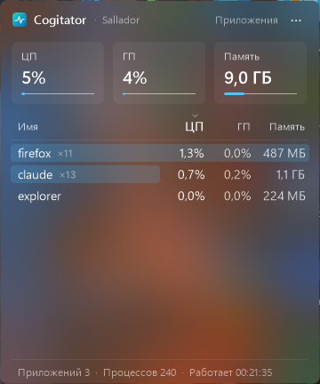

# Cogitator

**English** · [Русский](#русский)

Desktop widget for Windows 11 that shows, once per second, the **10 applications** using the most **CPU**, **GPU** and **RAM**, plus overall system load.

Version 2.4.0 · Developer: **Sallador**



## Features

- **Top 10 applications** — only real apps, meaning processes with a visible window, like the *Apps* group in Task Manager. Background processes can be shown from the menu.
- **Grouping** — processes with the same name are combined into one row, e.g. `firefox ×11`.
- **Sorting** by CPU, GPU or memory — click a column header. The choice is remembered.
- **Summary tiles** — overall CPU, GPU and memory load with progress bars. Values of 85% and above turn red.
- **Accurate numbers** — CPU like Task Manager; memory is the private working set (the *Memory* column in Task Manager); GPU is the load of the busiest GPU engine.
- **Windows 11 design** — Acrylic backdrop, rounded corners and system shadow. Follows the light/dark theme and accent colour, switching on the fly. The background can be made solid.
- **Stays on the desktop** — survives *Show desktop* (Win+D). Optionally "Always on top".
- **Drag anywhere** — the position is remembered.
- **Tray icon** — left click hides or shows the widget; right click opens the menu. The tooltip shows current CPU/GPU/RAM.
- **Start with Windows** (optional).
- **Light on resources** — about 5–6 MB of RAM, runs in Efficiency mode at low priority. Stops updating while hidden.

## Install

Run `Cogitator_Setup_2.4.0.exe` from [Releases](../../../releases). No admin rights needed. It installs to `%LOCALAPPDATA%\Programs\Cogitator`, adds a Start menu entry and optionally a desktop shortcut and autostart. Uninstall from *Settings → Apps → Installed apps*.

Silent install:

```
Cogitator_Setup_2.4.0.exe /S [/D=<folder>] [/nodesktop] [/noautostart] [/nolaunch]
uninstall.exe /uninstall /S
```

## Usage

| Action | How |
|---|---|
| Move the widget | drag any empty area |
| Change sorting | click `ЦП` / `ГП` / `Память` header |
| Menu | `…` button, right-click the widget or the tray icon |
| Hide / show | left-click the tray icon |
| Background processes, transparent background, always on top, autostart | in the menu |

## Build

Visual Studio 2022 (C++ workload) → run `build.bat`. It produces `bin\Cogitator.exe` and `dist\Cogitator_Setup_2.4.0.exe`. The installer embeds the widget.

Settings are stored in `HKCU\Software\Sallador\Cogitator`.

---

<a id="русский"></a>

# Cogitator

[English](#cogitator) · **Русский**

Виджет для рабочего стола Windows 11: раз в секунду показывает **10 приложений**, которые больше всего нагружают **ЦП**, **ГП** и **память**, и общую загрузку системы.

Версия 2.4.0 · Разработчик: **Sallador**

## Возможности

- **Топ-10 приложений** — только настоящие приложения, то есть процессы с видимым окном, как раздел «Приложения» в Диспетчере задач. Фоновые процессы можно включить в меню.
- **Группировка** — процессы с одинаковым именем объединяются в одну строку, например `firefox ×11`.
- **Сортировка** по ЦП, ГП или памяти — клик по заголовку столбца. Выбор запоминается.
- **Плитки сводки** — общая загрузка ЦП, ГП и памяти с индикаторами. Значения от 85% подсвечиваются красным.
- **Точные значения** — ЦП как в Диспетчере задач; память — частный рабочий набор (столбец «Память» в Диспетчере задач); ГП — загрузка самого нагруженного движка видеокарты.
- **Дизайн Windows 11** — подложка Acrylic, скруглённые углы, системная тень. Следует светлой/тёмной теме и акцентному цвету, переключается на лету. Фон можно сделать сплошным.
- **Живёт на рабочем столе** — не пропадает при «Свернуть все окна» (Win+D). По желанию — «Поверх всех окон».
- **Перетаскивается мышью** за любое свободное место, позиция запоминается.
- **Значок в трее** — левый клик скрывает или показывает виджет, правый открывает меню. В подсказке — текущие ЦП/ГП/память.
- **Автозапуск с Windows** (по желанию).
- **Экономный** — около 5–6 МБ памяти, работает в режиме эффективности с пониженным приоритетом. Пока виджет скрыт, обновления останавливаются.

## Установка

Запустите `Cogitator_Setup_2.4.0.exe` из [Releases](../../../releases). Права администратора не нужны. Программа ставится в `%LOCALAPPDATA%\Programs\Cogitator`, добавляет ярлык в меню «Пуск», по желанию — ярлык на рабочем столе и автозапуск. Удаление — «Параметры → Приложения → Установленные приложения».

Тихая установка:

```
Cogitator_Setup_2.4.0.exe /S [/D=<папка>] [/nodesktop] [/noautostart] [/nolaunch]
uninstall.exe /uninstall /S
```

## Использование

| Действие | Как |
|---|---|
| Переместить виджет | перетащить за любое свободное место |
| Сменить сортировку | клик по заголовку `ЦП` / `ГП` / `Память` |
| Меню | кнопка `…`, правый клик по виджету или по значку в трее |
| Скрыть / показать | левый клик по значку в трее |
| Фоновые процессы, прозрачный фон, поверх окон, автозапуск | в меню |

## Сборка

Visual Studio 2022 (компонент C++) → запустите `build.bat`. Получите `bin\Cogitator.exe` и `dist\Cogitator_Setup_2.4.0.exe`. Установщик содержит виджет внутри.

Настройки хранятся в `HKCU\Software\Sallador\Cogitator`.
