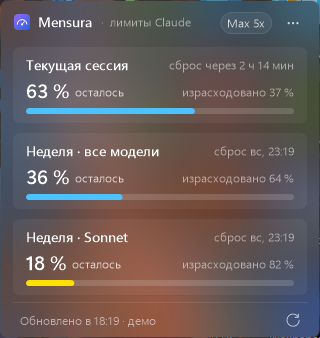

# Mensura

**English** · [Русский](#русский)

A desktop widget that keeps your remaining **Claude** plan usage always in sight: the current 5-hour session and the weekly limits, with time until each one resets. The same numbers as the `/usage` screen in Claude Code, without opening it.

Version 1.2.0 · Developer: **Sallador**



## Features

- **Session and weekly limits.** Shows the current session (5 hours), the weekly limit for all models and per-model weekly limits when your plan has them. Each limit shows the percentage, a progress bar and when it resets: "resets in 2 h 14 min", or the day and time for weekly limits.
- **Remaining or used.** Show what is left (default) or what has been used. The bar turns yellow at 25 % left and red at 10 % left.
- **Warnings.** A Windows notification when a limit reaches 80 % and 95 % used, once per reset window.
- **Plan badge.** Shows your plan (Pro, Max 5x, Max 20x).
- **Auto refresh.** Every 1, 2, 5 or 10 minutes, plus a refresh button. The widget also refreshes right after a limit resets and after the PC wakes from sleep.
- **Tray icon.** The tooltip shows the remaining limits. Left-click shows or hides the widget.
- **Windows 11 design.** Acrylic background, rounded corners, Segoe UI Variable, light/dark theme and accent colour. Drag it anywhere; it stays on the desktop after *Show desktop* (Win + D). Optional "always on top".
- **Light on resources.** About 3 MB of RAM. Native C++ / Win32, no .NET or browser engine.

## Where the data comes from

Anthropic has no official public API for subscription usage limits. Mensura does what Claude Code does: it reads your local Claude Code sign-in (`%USERPROFILE%\.claude\.credentials.json`) and requests the limits from `api.anthropic.com`.

- The token is only read from the file and sent to Anthropic. It is never stored, shown or sent anywhere else.
- You need to be signed in to Claude Code with a Claude subscription (Pro / Max). API key usage is not shown.
- The sign-in token lives a few hours. When it expires, Mensura renews it the same way Claude Code does and saves it back to the same file, so the `claude` CLI stays signed in too. A backup copy is kept as `.credentials.json.mensura-backup`.
- Signed in only in the Claude desktop app? It keeps its sign-in encrypted, so other programs can't use it. Install Claude Code (`irm https://claude.ai/install.ps1 | iex`) and sign in once with `claude`.
- The endpoint is unofficial. If Anthropic changes it, the widget may stop working until it is updated.

## Install

Run `Mensura_Setup_1.2.0.exe` from [Releases](../../../releases). No admin rights needed. It installs to `%LOCALAPPDATA%\Programs\Mensura`. Uninstall from *Settings → Apps*.

Silent install:

```
Mensura_Setup_1.2.0.exe /S [/D=<folder>] [/nodesktop] [/noautostart] [/nolaunch]
uninstall.exe /uninstall /S
```

## Usage

Right-click the widget or click **…** for the menu. Drag the widget with the mouse. `Mensura.exe /demo` shows sample data without a network connection.

## Build

Visual Studio 2022 (C++ workload) → run `build.bat`. It produces `bin\Mensura.exe` and `dist\Mensura_Setup_1.2.0.exe`.

Settings are stored in `HKCU\Software\Sallador\Mensura`.

Mensura is an independent project. It is not affiliated with or endorsed by Anthropic. Claude is a trademark of Anthropic.

---

<a id="русский"></a>

# Mensura

[English](#mensura) · **Русский**

Виджет для рабочего стола, на котором всегда виден остаток лимитов подписки **Claude**: текущая 5-часовая сессия и недельные лимиты, а также время до их сброса. Те же цифры, что на экране `/usage` в Claude Code, но без необходимости его открывать.

Версия 1.2.0 · Разработчик: **Sallador**

## Возможности

- **Лимиты сессии и недели.** Текущая сессия (5 часов), недельный лимит на все модели и отдельные недельные лимиты по моделям, если они есть в вашем тарифе. Для каждого показаны процент, индикатор и время сброса: «сброс через 2 ч 14 мин», а для недельных лимитов — день и время.
- **Остаток или израсходованное.** Можно показывать остаток (по умолчанию) или израсходованную часть. Индикатор становится жёлтым, когда остаётся 25 %, и красным, когда остаётся 10 %.
- **Предупреждения.** Уведомление Windows, когда лимит израсходован на 80 % и на 95 %, — один раз за период до сброса.
- **Тариф.** Значок с названием тарифа (Pro, Max 5x, Max 20x).
- **Автообновление.** Каждые 1, 2, 5 или 10 минут, а также кнопкой. Кроме того, виджет обновляется сразу после сброса лимита и после выхода компьютера из сна.
- **Значок в трее.** В подсказке виден остаток лимитов. Левый клик показывает или скрывает виджет.
- **Дизайн Windows 11.** Подложка Acrylic, скруглённые углы, Segoe UI Variable, светлая/тёмная тема и акцентный цвет. Виджет можно перетащить куда угодно; он остаётся на рабочем столе после «Свернуть все окна» (Win + D). Можно закрепить поверх всех окон.
- **Экономный.** Около 3 МБ памяти. Нативный C++ / Win32, без .NET и браузерного движка.

## Откуда берутся данные

У Anthropic нет официального публичного API для лимитов подписки. Mensura делает то же, что Claude Code: читает локальный вход в Claude Code (`%USERPROFILE%\.claude\.credentials.json`) и запрашивает лимиты у `api.anthropic.com`.

- Токен только читается из файла и отправляется в Anthropic. Виджет его не хранит, не показывает и никуда больше не передаёт.
- Нужно войти в Claude Code с подпиской Claude (Pro / Max). Расход по API-ключу не отображается.
- Токен входа действует несколько часов. Когда срок истекает, Mensura продлевает его так же, как это делает Claude Code, и сохраняет обратно в тот же файл, поэтому консольный `claude` тоже остаётся в системе. Резервная копия хранится в `.credentials.json.mensura-backup`.
- Вошли только в приложение Claude? Оно хранит вход в зашифрованном виде, и другие программы его использовать не могут. Установите Claude Code (`irm https://claude.ai/install.ps1 | iex`) и один раз войдите командой `claude`.
- Используется неофициальный адрес. Если Anthropic его изменит, виджет может перестать работать до обновления.

## Установка

Запустите `Mensura_Setup_1.2.0.exe` из [Releases](../../../releases). Права администратора не нужны. Программа ставится в `%LOCALAPPDATA%\Programs\Mensura`. Удаление — «Параметры → Приложения».

Тихая установка:

```
Mensura_Setup_1.2.0.exe /S [/D=<папка>] [/nodesktop] [/noautostart] [/nolaunch]
uninstall.exe /uninstall /S
```

## Использование

Меню — правый клик по виджету или кнопка **…**. Виджет перетаскивается мышью. `Mensura.exe /demo` показывает пример данных без подключения к сети.

## Сборка

Visual Studio 2022 (компонент C++) → запустите `build.bat`. Получите `bin\Mensura.exe` и `dist\Mensura_Setup_1.2.0.exe`.

Настройки хранятся в `HKCU\Software\Sallador\Mensura`.

Mensura — независимый проект, не связанный с Anthropic и не одобренный ею. Claude — товарный знак Anthropic.
