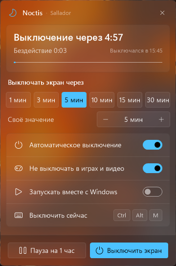

# Noctis

**English** · [Русский](#русский)

Turns the monitor off after N minutes of inactivity and wakes it on mouse movement or a key press — like the built-in Windows display timeout, but more reliable. It only looks at **your** input, so browsers, game launchers, open video tabs or drivers can't keep the screen awake. The PC keeps working: downloads, music and torrents are not interrupted.

Version 1.1.0 · Developer: **Sallador**



## Features

- **Inactivity timeout** — 1 / 3 / 5 / 10 / 15 / 30 minutes, or any value from 1 to 240 minutes.
- **Turn the screen off now** — use any of these:
  - **Ctrl + Alt + M**
  - the *Turn off screen* button
  - a desktop / Start menu shortcut
  - `Noctis.exe /off`
- **Protection from accidental wake-up** — the screen turns off only after you release the keys or mouse button. Mouse jitter in the first 1.5 seconds turns it off again.
- **Games and video** — the screen is not turned off while a full-screen app is running. This can be disabled.
- **Protection from "alarm clocks"** — if a program, not you, wakes the screen, Noctis turns it off again.
- **Pause for 1 hour** — the tray icon dims.
- **Start with Windows** — quietly in the tray.
- **Windows 11 design** — Acrylic flyout above the tray like Quick Settings, Settings-style toggles, a live countdown with a progress bar. Follows the light/dark theme and accent colour. The monochrome tray icon matches the taskbar.
- **Light on resources** — about 2–3 MB of RAM. The window buffer is released while the flyout is closed.

## Install

Run `Noctis_Setup_1.1.0.exe` from [Releases](../../../releases). No admin rights needed. It installs to `%LOCALAPPDATA%\Programs\Noctis`. Uninstall from *Settings → Apps*.

Silent install:

```
Noctis_Setup_1.1.0.exe /S [/D=<folder>] [/nodesktop] [/noautostart] [/nolaunch]
uninstall.exe /uninstall /S
```

## Usage

The moon icon in the tray: **left click** opens settings, **right click** opens the menu.

Command line: `Noctis.exe /off` turns the screen off now; `Noctis.exe /autostart` starts silently.

## Build

Visual Studio 2022 (C++ workload) → run `build.bat`. It produces `bin\Noctis.exe` and `dist\Noctis_Setup_1.1.0.exe`.

Settings are stored in `HKCU\Software\Sallador\Noctis`.

---

<a id="русский"></a>

# Noctis

[English](#noctis) · **Русский**

Выключает монитор после N минут вашего бездействия и включает его при движении мыши или нажатии клавиши. Работает как встроенный таймер Windows, но надёжнее: смотрит только на **ваш** ввод, поэтому браузеры, игровые клиенты, открытые вкладки с видео и драйверы не мешают экрану погаснуть. Компьютер при этом продолжает работать: загрузки, музыка и торренты не прерываются.

Версия 1.1.0 · Разработчик: **Sallador**

## Возможности

- **Время бездействия** — 1 / 3 / 5 / 10 / 15 / 30 минут или любое значение от 1 до 240 минут.
- **Выключить экран сразу** — любым из способов:
  - **Ctrl + Alt + M**
  - кнопка «Выключить экран»
  - ярлык на рабочем столе или в «Пуске»
  - `Noctis.exe /off`
- **Защита от случайного пробуждения** — экран гаснет только после того, как отпущены клавиши или кнопка мыши. Дрожание мыши в первые 1,5 секунды снова гасит экран.
- **Игры и видео** — пока открыто полноэкранное приложение, экран не выключается. Можно отключить.
- **Защита от «будильников»** — если экран включила программа, а не вы, Noctis снова его выключает.
- **Пауза на 1 час** — значок в трее становится бледным.
- **Автозапуск с Windows** — тихо, сразу в трей.
- **Дизайн Windows 11** — панель Acrylic над треем, как «Быстрые настройки», переключатели как в «Параметрах», живой обратный отсчёт с индикатором. Следует светлой/тёмной теме и акцентному цвету. Монохромный значок в трее подстраивается под панель задач.
- **Экономная** — около 2–3 МБ памяти. Буфер окна освобождается, пока панель закрыта.

## Установка

Запустите `Noctis_Setup_1.1.0.exe` из [Releases](../../../releases). Права администратора не нужны. Программа ставится в `%LOCALAPPDATA%\Programs\Noctis`. Удаление — «Параметры → Приложения».

Тихая установка:

```
Noctis_Setup_1.1.0.exe /S [/D=<папка>] [/nodesktop] [/noautostart] [/nolaunch]
uninstall.exe /uninstall /S
```

## Использование

Значок луны в трее: **левый клик** открывает настройки, **правый** — меню.

Командная строка: `Noctis.exe /off` — выключить экран сейчас; `Noctis.exe /autostart` — тихий запуск.

## Сборка

Visual Studio 2022 (компонент C++) → запустите `build.bat`. Получите `bin\Noctis.exe` и `dist\Noctis_Setup_1.1.0.exe`.

Настройки хранятся в `HKCU\Software\Sallador\Noctis`.
