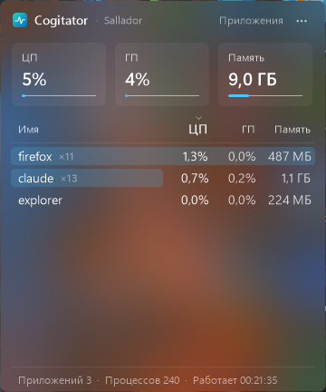

# Cogitator & Noctis

**English** · [Русский](#русский)

Two tiny native utilities for Windows 11 by **Sallador**, built in the Windows 11 Fluent Design style.

| | App | What it does |
|---|---|---|
|  | **[Cogitator](Cogitator/)** | Desktop widget that shows, in real time, the 10 applications using the most **CPU**, **GPU** and **RAM**, plus overall system load. |
|  | **[Noctis](Noctis/)** | Turns the monitor off after N minutes of inactivity and wakes it on mouse or keyboard input — like the built-in Windows timer, but it doesn't let browsers, game launchers or drivers keep the screen awake. |

### Common to both

- **Native and lightweight** — pure C++ / Win32 + GDI+, no .NET, Electron or browser engine. A single small `.exe`, only a few MB of RAM.
- **Windows 11 look** — Mica / Acrylic backdrop, rounded corners, Segoe UI Variable, Segoe Fluent Icons, Settings-style toggles. They follow the system light/dark theme and accent colour automatically.
- **No admin rights** — per-user installer (`%LOCALAPPDATA%\Programs`), uninstall from *Settings → Apps*. Silent install supported.
- **Start with Windows** — optional, can be turned on in the installer or the app menu.
- **Russian interface.**

### Download

Get the installers from **[Releases](../../releases)**:

- `Cogitator_Setup_2.1.0.exe`
- `Noctis_Setup_1.1.0.exe`

The installers are not code-signed, so Windows SmartScreen may show *"Windows protected your PC"*. Click **More info → Run anyway**.

### Building from source

Requires Visual Studio 2022 (or Build Tools) with the *Desktop development with C++* workload. Run `build.bat` inside `Cogitator\` or `Noctis\`. It produces `bin\<App>.exe` and the installer in `dist\`.

Tested on Windows 11.

---

# Cogitator и Noctis

[English](#cogitator--noctis) · **Русский**

Две маленькие нативные утилиты для Windows 11 от **Sallador** в стиле Windows 11 (Fluent Design).

| | Программа | Что делает |
|---|---|---|
|  | **[Cogitator](Cogitator/)** | Виджет для рабочего стола: в реальном времени показывает 10 приложений, которые больше всего нагружают **ЦП**, **ГП** и **память**, и общую загрузку системы. |
|  | **[Noctis](Noctis/)** | Выключает монитор после N минут бездействия и включает его при движении мыши или нажатии клавиши. Работает как встроенный таймер Windows, но браузеры, игровые клиенты и драйверы не мешают экрану погаснуть. |

### Общее для обеих

- **Нативные и лёгкие** — чистый C++ / Win32 + GDI+, без .NET, Electron и браузерного движка. Один небольшой `.exe`, несколько мегабайт памяти.
- **Внешний вид Windows 11** — подложка Mica / Acrylic, скруглённые углы, Segoe UI Variable, значки Segoe Fluent Icons, переключатели как в «Параметрах». Сами подстраиваются под светлую/тёмную тему и акцентный цвет системы.
- **Без прав администратора** — установка в профиль пользователя (`%LOCALAPPDATA%\Programs`), удаление через «Параметры → Приложения». Есть тихая установка.
- **Автозапуск с Windows** — по желанию, включается в установщике или в меню программы.
- **Интерфейс на русском языке.**

### Скачать

Установщики — в разделе **[Releases](../../releases)**:

- `Cogitator_Setup_2.1.0.exe`
- `Noctis_Setup_1.1.0.exe`

Установщики не подписаны цифровой подписью, поэтому SmartScreen может показать *«Система Windows защитила ваш компьютер»*. Нажмите **Подробнее → Выполнить в любом случае**.

### Сборка из исходников

Нужна Visual Studio 2022 (или Build Tools) с компонентом *«Разработка классических приложений на C++»*. Запустите `build.bat` в папке `Cogitator\` или `Noctis\` — получите `bin\<Программа>.exe` и установщик в `dist\`.

Проверено на Windows 11.
