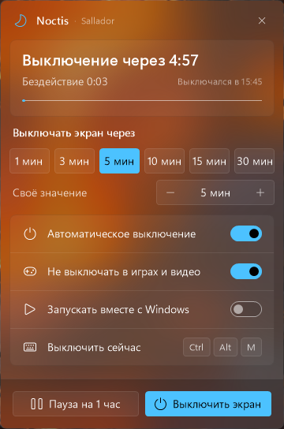
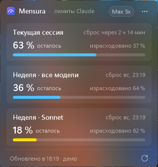
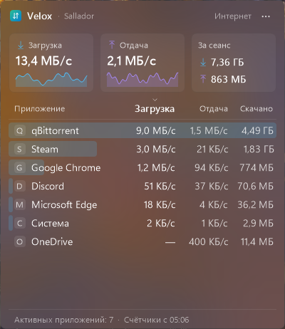

# Cogitator, Noctis, Mensura & Velox

**English** · [Русский](#русский)

Four tiny native utilities for Windows 11 by **Sallador**, built in the Windows 11 Fluent Design style.

| | App | What it does |
|---|---|---|
|  | **[Cogitator](Cogitator/)** | Desktop widget that shows, in real time, the 10 applications using the most **CPU**, **GPU** and **RAM**, plus overall system load. |
|  | **[Noctis](Noctis/)** | Turns the monitor off after N minutes of inactivity and wakes it on mouse or keyboard input — like the built-in Windows timer, but it doesn't let browsers, game launchers or drivers keep the screen awake. You can also turn the screen off instantly at any moment: with a button on the desktop, in the app, or with Ctrl + Alt + M. |
|  | **[Mensura](Mensura/)** | Desktop widget that keeps your remaining **Claude** plan usage in sight: the 5-hour session and weekly limits, with time until reset and warnings at 80 % and 95 %. Uses your Claude Code sign-in. |
|  | **[Velox](Velox/)** | Desktop widget that shows which applications use the internet right now: download and upload speed per application, downloaded volume, total speed with a graph. |

### Common to all

- **Native and lightweight** — pure C++ / Win32 + GDI+, no .NET, Electron or browser engine. A single small `.exe`, only a few MB of RAM.
- **Windows 11 look** — Mica / Acrylic backdrop, rounded corners, Segoe UI Variable, Segoe Fluent Icons, Settings-style toggles. They follow the system light/dark theme and accent colour automatically.
- **No admin rights** (except Velox, see its README) — per-user installer (`%LOCALAPPDATA%\Programs`), uninstall from *Settings → Apps*. Silent install supported.
- **Start with Windows** — optional, can be turned on in the installer or the app menu.
- **Russian and English interface.** The language follows Windows and can be switched in the app menu (*Language · Язык*).

### Download

Get the installers from **[Releases](../../releases)**:

- `Cogitator_Setup_2.2.0.exe`
- `Noctis_Setup_1.2.0.exe`
- `Mensura_Setup_1.1.0.exe`
- `Velox_Setup_1.1.0.exe`

The installers are not code-signed, so Windows SmartScreen may show *"Windows protected your PC"*. Click **More info → Run anyway**.

### Building from source

Requires Visual Studio 2022 (or Build Tools) with the *Desktop development with C++* workload. Run `build.bat` inside `Cogitator\`, `Noctis\`, `Mensura\` or `Velox\`. It produces `bin\<App>.exe` and the installer in `dist\`.

Tested on Windows 11.

---

# Cogitator, Noctis, Mensura и Velox

[English](#cogitator-noctis-mensura--velox) · **Русский**

Четыре маленькие нативные утилиты для Windows 11 от **Sallador** в стиле Windows 11 (Fluent Design).

| | Программа | Что делает |
|---|---|---|
|  | **[Cogitator](Cogitator/)** | Виджет для рабочего стола: в реальном времени показывает 10 приложений, которые больше всего нагружают **ЦП**, **ГП** и **память**, и общую загрузку системы. |
|  | **[Noctis](Noctis/)** | Выключает монитор после N минут бездействия и включает его при движении мыши или нажатии клавиши. Работает как встроенный таймер Windows, но браузеры, игровые клиенты и драйверы не мешают экрану погаснуть. Кроме того, экран можно выключить мгновенно в любой момент — кнопкой на рабочем столе, в приложении или сочетанием Ctrl + Alt + M. |
|  | **[Mensura](Mensura/)** | Виджет для рабочего стола с остатком лимитов подписки **Claude**: 5-часовая сессия и недельные лимиты, время до сброса и предупреждения при 80 % и 95 %. Использует вход в Claude Code. |
|  | **[Velox](Velox/)** | Виджет для рабочего стола: какие приложения сейчас пользуются интернетом, скорость загрузки и отдачи каждого, скачанный объём и общая скорость с графиком. |

### Общее для всех

- **Нативные и лёгкие** — чистый C++ / Win32 + GDI+, без .NET, Electron и браузерного движка. Один небольшой `.exe`, несколько мегабайт памяти.
- **Внешний вид Windows 11** — подложка Mica / Acrylic, скруглённые углы, Segoe UI Variable, значки Segoe Fluent Icons, переключатели как в «Параметрах». Сами подстраиваются под светлую/тёмную тему и акцентный цвет системы.
- **Без прав администратора** (кроме Velox, см. его описание) — установка в профиль пользователя (`%LOCALAPPDATA%\Programs`), удаление через «Параметры → Приложения». Есть тихая установка.
- **Автозапуск с Windows** — по желанию, включается в установщике или в меню программы.
- **Интерфейс на русском и английском.** Язык выбирается по языку Windows, переключить его можно в меню программы («Язык · Language»).

### Скачать

Установщики — в разделе **[Releases](../../releases)**:

- `Cogitator_Setup_2.2.0.exe`
- `Noctis_Setup_1.2.0.exe`
- `Mensura_Setup_1.1.0.exe`
- `Velox_Setup_1.1.0.exe`

Установщики не подписаны цифровой подписью, поэтому SmartScreen может показать *«Система Windows защитила ваш компьютер»*. Нажмите **Подробнее → Выполнить в любом случае**.

### Сборка из исходников

Нужна Visual Studio 2022 (или Build Tools) с компонентом *«Разработка классических приложений на C++»*. Запустите `build.bat` в папке `Cogitator\`, `Noctis\`, `Mensura\` или `Velox\` — получите `bin\<Программа>.exe` и установщик в `dist\`.

Проверено на Windows 11.
