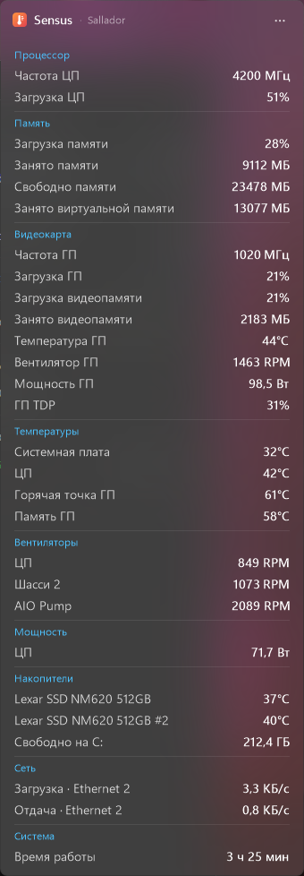

# Sensus

**English** · [Русский](#русский)

A desktop widget with your PC's sensors: clocks, loads, memory, temperatures, fans, power and network. Show only what you need: every sensor can be turned on or off.

Version 1.2.0 · Developer: **Sallador**



## What it shows

Without any extra software:

- **Processor:** effective clock (like Task Manager), load, processes, threads.
- **Memory:** load, used, free, virtual memory used and load, system cache.
- **Graphics card:** load, clock, memory clock, temperature, fan speed, video memory load and usage. On NVIDIA cards also power draw, TDP % and fan %.
- **Drives:** NVMe temperatures, free space on every drive.
- **Network:** download and upload speed for each network adapter.
- **System:** uptime, battery charge on laptops.

With **AIDA64** (optional), everything AIDA64 measures:

- CPU, motherboard, GPU hotspot, GPU memory and SATA drive temperatures;
- CPU, chassis and pump fans;
- CPU power and other power readings;
- voltages and currents.

Windows does not let ordinary programs read CPU and motherboard sensors without a kernel driver, so Sensus takes them from AIDA64. To enable this, in AIDA64 open **Preferences → Hardware Monitoring → External Applications** and turn on **Enable shared memory**. Sensus picks the sensors up automatically.

## Features

- **Choose sensors.** Double-click the widget or choose **Choose sensors…** in the menu. A switch for every sensor, grouped like the widget.
- **Colour hints.** Temperatures turn yellow at 70 °C and red at 85 °C.
- **Refresh** every 1, 2 or 5 seconds.
- **One or two columns.** Menu → *Layout*: one column, two columns, or automatic (two columns only when one does not fit on the screen). Whatever still does not fit scrolls with the mouse wheel.
- **Windows 11 design.** Acrylic background, Mica settings window, rounded corners, Segoe UI Variable, light/dark theme and accent colour. Drag it anywhere; it stays on the desktop after *Show desktop* (Win + D). Optional "always on top".
- **Russian and English interface.**
- **Light on resources.** About 3 MB of RAM. Native C++ / Win32, no .NET or browser engine, no driver, no administrator rights.

## Install

Run `Sensus_Setup_1.2.0.exe` from [Releases](../../../releases). No admin rights needed. It installs to `%LOCALAPPDATA%\Programs\Sensus`. Uninstall from *Settings → Apps*.

Silent install:

```
Sensus_Setup_1.2.0.exe /S [/D=<folder>] [/nodesktop] [/noautostart] [/nolaunch]
uninstall.exe /uninstall /S
```

`Sensus.exe /demo` shows sample data.

## Build

Visual Studio 2022 (C++ workload) → run `build.bat`. It produces `bin\Sensus.exe` and `dist\Sensus_Setup_1.2.0.exe`.

Settings are stored in `HKCU\Software\Sallador\Sensus`.

---

<a id="русский"></a>

# Sensus

[English](#sensus) · **Русский**

Виджет для рабочего стола с датчиками компьютера: частоты, загрузка, память, температуры, вентиляторы, мощность и сеть. Показывает только то, что вам нужно: любой параметр можно включить или выключить.

Версия 1.2.0 · Разработчик: **Sallador**

## Что показывает

Без дополнительных программ:

- **Процессор:** реальная частота (как в Диспетчере задач), загрузка, число процессов и потоков.
- **Память:** загрузка, занято, свободно, занято и загрузка виртуальной памяти, системный кэш.
- **Видеокарта:** загрузка, частота, частота видеопамяти, температура, обороты вентилятора, загрузка и объём занятой видеопамяти. На видеокартах NVIDIA ещё мощность, TDP в процентах и вентилятор в процентах.
- **Накопители:** температура NVMe-дисков, свободное место на каждом диске.
- **Сеть:** скорость загрузки и отдачи для каждого сетевого адаптера.
- **Система:** время работы, заряд батареи на ноутбуках.

С **AIDA64** (по желанию) — всё, что измеряет AIDA64:

- температуры процессора, материнской платы, горячей точки и памяти видеокарты, SATA-дисков;
- вентиляторы процессора, корпуса и помпы;
- мощность процессора и другие показатели питания;
- напряжения и токи.

Windows не даёт обычным программам читать датчики процессора и материнской платы без драйвера ядра, поэтому Sensus берёт их из AIDA64. Чтобы это включить, в AIDA64 откройте **Настройки → Аппаратный мониторинг → Внешние приложения** и включите **общую память** (Enable shared memory). Sensus подхватит датчики автоматически.

## Возможности

- **Выбор параметров.** Двойной щелчок по виджету или пункт меню **«Выбрать параметры…»**. Для каждого датчика есть переключатель; датчики сгруппированы так же, как в виджете.
- **Цветовые подсказки.** Температура становится жёлтой при 70 °C и красной при 85 °C.
- **Обновление** каждые 1, 2 или 5 секунд.
- **В один или два ряда.** Меню → «Расположение»: в один ряд, в два ряда или автоматически (два ряда, только если в один не помещается). То, что всё равно не помещается, прокручивается колесом мыши.
- **Дизайн Windows 11.** Подложка Acrylic, окно параметров с Mica, скруглённые углы, Segoe UI Variable, светлая/тёмная тема и акцентный цвет. Виджет можно перетащить куда угодно; он остаётся на рабочем столе после «Свернуть все окна» (Win + D). Можно закрепить поверх всех окон.
- **Интерфейс на русском и английском.**
- **Экономный.** Около 3 МБ памяти. Нативный C++ / Win32, без .NET, браузерного движка, драйверов и прав администратора.

## Установка

Запустите `Sensus_Setup_1.2.0.exe` из [Releases](../../../releases). Права администратора не нужны. Программа ставится в `%LOCALAPPDATA%\Programs\Sensus`. Удаление — «Параметры → Приложения».

Тихая установка:

```
Sensus_Setup_1.2.0.exe /S [/D=<папка>] [/nodesktop] [/noautostart] [/nolaunch]
uninstall.exe /uninstall /S
```

`Sensus.exe /demo` показывает пример данных.

## Сборка

Visual Studio 2022 (компонент C++) → запустите `build.bat`. Получите `bin\Sensus.exe` и `dist\Sensus_Setup_1.2.0.exe`.

Настройки хранятся в `HKCU\Software\Sallador\Sensus`.
