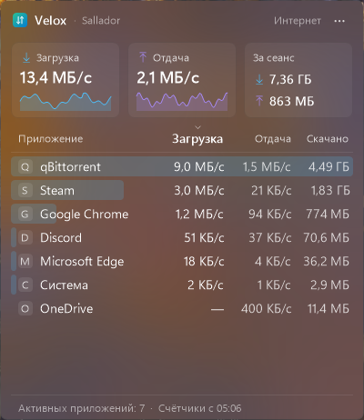

# Velox

**English** · [Русский](#русский)

A desktop widget that shows which applications are using the internet right now, at what speed, and how much each of them has downloaded.

Version 1.2.0 · Developer: **Sallador**



## Features

- **Per-application traffic.** The top 10 applications with download speed, upload speed and the amount downloaded since the widget started. Applications show their real names and icons ("Google Chrome", not `chrome.exe`). All processes of one application are combined.
- **Total speed.** Download and upload tiles with a 60-second graph, plus the volume downloaded and uploaded in this session.
- **Internet only, by default.** Traffic inside your home network (NAS, printer, other PCs) and loopback traffic are not counted. LAN traffic can be included from the menu.
- **Sorting.** Click a column header: download, upload or downloaded volume.
- **Units.** MB/s (default) or Mbit/s, like your internet plan.
- **Reset counters** at any moment.
- **Windows 11 design.** Acrylic background, rounded corners, Segoe UI Variable, light/dark theme and accent colour. Drag it anywhere; it stays on the desktop after *Show desktop* (Win + D). Optional "always on top".
- **Light on resources.** About 7 MB of RAM and almost no CPU. Native C++ / Win32, no .NET or browser engine.

## Why administrator rights

Windows gives per-application network statistics only to administrators. Resource Monitor works the same way. Velox reads them from the Windows kernel network event stream (ETW).

To avoid a UAC prompt every time, the installer asks for administrator rights **once** and creates two tasks in Task Scheduler (folder `Sallador`). Through them the widget starts with the required rights at logon and from the shortcuts.

Without administrator rights Velox runs in a limited mode: it shows only the total speed and offers a button to restart with rights.

## Install

Run `Velox_Setup_1.2.0.exe` from [Releases](../../../releases) and confirm the UAC prompt. It installs to `C:\Program Files\Velox`. Uninstall from *Settings → Apps*. The uninstaller also removes the Task Scheduler tasks.

Silent install (from an elevated prompt):

```
Velox_Setup_1.2.0.exe /S [/D=<folder>] [/nodesktop] [/noautostart] [/nolaunch]
uninstall.exe /uninstall /S
```

## Usage

Right-click the widget or click **…** for the menu. Drag the widget with the mouse. Left-click the tray icon to show or hide it. `Velox.exe /demo` shows sample data.

## How the numbers are counted

- The application speeds count useful data (TCP / UDP payload). The tiles at the top count everything passing through the network adapters, including protocol overhead, so they can be a little higher than the sum of the rows.
- Traffic of system services (Windows Update, Delivery Optimization) appears under **svchost** or **System**.

## Build

Visual Studio 2022 (C++ workload) → run `build.bat`. It produces `bin\Velox.exe` and `dist\Velox_Setup_1.2.0.exe`.

Settings are stored in `HKCU\Software\Sallador\Velox`.

---

<a id="русский"></a>

# Velox

[English](#velox) · **Русский**

Виджет для рабочего стола, который показывает, какие приложения пользуются интернетом прямо сейчас, с какой скоростью и сколько каждое из них уже скачало.

Версия 1.2.0 · Разработчик: **Sallador**

## Возможности

- **Трафик по приложениям.** 10 самых активных приложений со скоростью загрузки и отдачи и объёмом, скачанным с момента запуска виджета. У приложений отображаются настоящие названия и значки («Google Chrome», а не `chrome.exe`). Все процессы одного приложения объединяются.
- **Общая скорость.** Плитки загрузки и отдачи с графиком за последние 60 секунд, а также объём, скачанный и отданный за сеанс.
- **По умолчанию считается только интернет.** Трафик внутри домашней сети (NAS, принтер, другие компьютеры) и локальный трафик компьютера не учитываются. Локальную сеть можно включить в меню.
- **Сортировка.** Щелчок по заголовку столбца: загрузка, отдача или скачанный объём.
- **Единицы измерения.** МБ/с (по умолчанию) или Мбит/с — как в тарифе провайдера.
- **Сброс счётчиков** в любой момент.
- **Дизайн Windows 11.** Подложка Acrylic, скруглённые углы, Segoe UI Variable, светлая/тёмная тема и акцентный цвет. Виджет можно перетащить куда угодно; он остаётся на рабочем столе после «Свернуть все окна» (Win + D). Можно закрепить поверх всех окон.
- **Экономный.** Около 7 МБ памяти и почти нулевая нагрузка на процессор. Нативный C++ / Win32, без .NET и браузерного движка.

## Зачем права администратора

Windows отдаёт статистику сети по приложениям только администраторам — так же работает и «Монитор ресурсов». Velox берёт её из потока сетевых событий ядра Windows (ETW).

Чтобы не показывать запрос UAC при каждом запуске, установщик **один раз** запрашивает права администратора и создаёт два задания в Планировщике заданий (папка `Sallador`). Через них виджет запускается с нужными правами при входе в систему и с ярлыков.

Без прав администратора Velox работает в ограниченном режиме: показывает только общую скорость и предлагает кнопку перезапуска с правами.

## Установка

Запустите `Velox_Setup_1.2.0.exe` из [Releases](../../../releases) и подтвердите запрос UAC. Программа ставится в `C:\Program Files\Velox`. Удаление — «Параметры → Приложения»; при этом удаляются и задания Планировщика.

Тихая установка (из командной строки с правами администратора):

```
Velox_Setup_1.2.0.exe /S [/D=<папка>] [/nodesktop] [/noautostart] [/nolaunch]
uninstall.exe /uninstall /S
```

## Использование

Меню — правый клик по виджету или кнопка **…**. Виджет перетаскивается мышью. Левый клик по значку в трее показывает или скрывает его. `Velox.exe /demo` показывает пример данных.

## Как считаются цифры

- Скорость приложений — это полезные данные (содержимое пакетов TCP / UDP). Плитки вверху считают всё, что проходит через сетевые адаптеры, включая служебные данные протоколов, поэтому они могут быть немного больше суммы строк.
- Трафик системных служб (Центр обновления Windows, оптимизация доставки) отображается как **svchost** или **Система**.

## Сборка

Visual Studio 2022 (компонент C++) → запустите `build.bat`. Получите `bin\Velox.exe` и `dist\Velox_Setup_1.2.0.exe`.

Настройки хранятся в `HKCU\Software\Sallador\Velox`.
